<a href="https://hesrun.cz">
  
</a>

<p align="center">
  <a href="https://hesrun.cz"></a>
  <a href="https://hesrun.cz/contact"></a>
  <a href="https://linkedin.com/in/vladyslav-otroshchenko"></a>
  <a href="mailto:info@hesrun.cz"></a>
</p>

<br>

### Hi, I’m Vladyslav 👋

Frontend engineer from **Karlovy Vary, Czechia**, with **10+ years** of building interfaces from scratch, from landing pages to complex applications. I make **websites and React apps that load in a blink, rank in search and turn visitors into clients**, and I’ve done it for luxury watch brands, auction houses and e‑commerce.

```ts
const vladyslav = {
  role: 'Frontend engineer',
  location: 'Karlovy Vary, CZ · remote / hybrid · CET',
  focus: ['Next.js & React', 'motion at 60 FPS', 'Core Web Vitals', 'AI integrations'],
  clients: ['Konstantin Chaykin', 'Ineichen Auctioneers', 'Artle', 'e-commerce'],
  status: 'Taking on new projects',
};
```

<br>

## 📈 Results, not just code

<table>
  <tr>
    <td align="center" width="25%"><h1>30+</h1><sub>projects shipped<br>at Tehmart</sub></td>
    <td align="center" width="25%"><h1>300+</h1><sub>pages turned<br>from design into code</sub></td>
    <td align="center" width="25%"><h1>200+</h1><sub>pages and screens<br>for a telemedicine app</sub></td>
    <td align="center" width="25%"><h1>60 FPS</h1><sub>target for every animation,<br>desktop and phone</sub></td>
  </tr>
</table>

**Pharmacy e‑shop rebuild** ([stmaria.cz](https://stmaria.cz)), frontend rebuilt without stopping sales:

| Metric | Before | After | |
|---|---:|---:|---|
| People on the site at the same time | 20 | **500** | `25×` |
| Orders per day | 10 | **160+** | `16×` |
| Average time on the site | 1 min | **5 min** | `5×` |
| Visitors on mobile | 15 % | **75 %** | `+60 pp` |

<br>

## 🛠️ What I build

| | |
|---|---|
| ⚡ **Websites and landing pages that sell** | Fast, search-friendly, content you edit yourself. Sub-second pages and a structure Google understands from day one. |
| ⚛️ **React web applications** | Dashboards, shops and internal tools with typed data from the database to the button: login, forms, payments. |
| 🤖 **AI integrations** | Assistants that answer from your own data, smart search, generated product descriptions, document processing. |
| ✨ **Animation and 3D** | Scroll stories, product reveals and WebGL scenes that keep visitors on the page and stay smooth on a mid-range phone. |
| 🚀 **Speed, SEO and analytics** | Core Web Vitals audits and fixes, structured data, conversion tracking and product feeds you can trust. |

<br>

## 🧰 Stack

**Core**<br>


**UI and motion**<br>


**State, data and backend**<br>


**AI**<br>


**Analytics and e‑commerce**<br>


**Tooling**<br>


<br>

## 🧭 Experience

- **2022 – now · Tehmart & independent projects**, frontend engineer (contract)<br>
  UI systems and bespoke responsive layouts for luxury brands and high-traffic platforms, including **Konstantin Chaykin** and **Ineichen Auctioneers**. GSAP and Three.js animation, React and Next.js apps built from zero.
- **2019 – 2025 · stmaria.cz**, frontend developer<br>
  Rebuilt a live pharmacy e‑shop: mobile-first UI, faster pages, technical SEO and feeds for Google, Seznam, Heureka and Zboží.cz. Results in the table above.
- **2013 – 2019 · Helpmed / Call2Doc**, frontend developer<br>
  Patient and doctor interfaces for a telemedicine service on an in-house UI component library, with real-time updates.

<br>

## 📬 Let’s work together

Have a website, an app or an AI feature in mind? **[Tell me about it on hesrun.cz →](https://hesrun.cz/contact)**<br>
You get a concrete reply with an approach, a timeline and a price range within two working days.

<p align="center"><sub>Built with 💖 and tea · <a href="https://hesrun.cz">hesrun.cz</a></sub></p>
